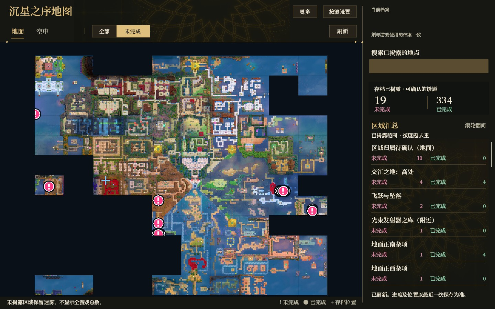

<h1 align="center">沉星之序地图</h1>
<p align="center">读取本地存档，查看未完成的谜题，方便后期查漏补缺。</p>
<p align="center">
  
  
  <a href="LICENSE"></a>
</p>
<p align="center"><a href="#功能">功能</a> · <a href="#界面预览">界面预览</a> · <a href="#下载与安装">下载与安装</a> · <a href="#兼容性">兼容性</a> · <a href="#常见问题">常见问题</a> · <a href="#来源与鸣谢">来源鸣谢</a></p>

《沉星之序》（Order of the Sinking Star）的非官方 Windows 地图工具。玩到后期找不到之前漏掉的谜题时，可以读取本地存档，在地图上查看未完成地点。

**默认保留探索迷雾，也可主动开启剧透模式，查看全地图未完成谜题。**

## 功能

| 功能 | 说明 |
|---|---|
| 查漏补缺 | 区分已完成和未完成谜题，支持完成状态筛选 |
| 迷雾保留 | 默认按所选存档已揭露的范围显示，未探索地点不进入默认搜索和计数 |
| 剧透模式 | 在“更多 → 显示范围”中主动选择“全地图未完成（剧透）” |
| 搜索与区域汇总 | 搜索已显示地点，按区域查看去重后的完成数量 |
| 分层地图 | 根据存档已揭露的地图层切换，支持缩放和拖动 |
| 自定义按键 | 打开/关闭地图、刷新地图的按键均可修改 |
| 本地读取 | 根据最近一次存档生成结果，不是实时定位或路线推荐 |
| 核实更新 | 校验完整旧载荷后更新并保留备份，遇到未知DLL或被修改文件会停止覆盖 |

## 界面预览

<details>
<summary>展开地图主界面预览（含已探索地图画面）</summary>



</details>

完成状态示例：编号使用辅助色，未完成柔粉、已完成灰绿。

| 未完成 | 已完成 |
|---|---|
|  |  |

以上是原生绘制路径的离屏预览；详情卡使用合成示例数据，不包含私人存档。它们不代表长期游戏内兼容性验收。

## 下载与安装

**[下载 0.1.16 完整离线安装包](https://github.com/catalpa379/sinking-star-map/releases/download/v0.1.16/Sinking-Star-Map-0.1.16-Offline.zip)** · [版本发布页](https://github.com/catalpa379/sinking-star-map/releases/tag/v0.1.16) · [SHA256 校验文件](https://github.com/catalpa379/sinking-star-map/releases/download/v0.1.16/Sinking-Star-Map-0.1.16-SHA256.txt)

普通玩家不需要编译。请下载完整离线安装包，不要把 GitHub 自动生成的 Source code 或仓库的“Download ZIP”当作安装包。校验文件中记录的是安装包上传前的中文文件名；下载后的英文文件名不同，但 SHA256 值相同。

安装步骤：

1. 完整解压安装包。
2. 正常退出游戏，运行“安装与卸载.exe”。
3. 核对Steam游戏目录，点击“安装 / 更新”。
4. 启动游戏，用设置的按键打开地图，选择与游戏一致的档案。

初始打开/关闭按键为 **F8**，刷新为 **F5**，均可在安装器或地图右上角“按键设置”中修改。卸载使用对应版本安装器，未知文件、存档、按键设置与旧版备份保留。

## 兼容性

| 项目 | 当前范围 |
|---|---|
| 系统 | Windows x64 |
| 游戏 | Steam Build **26006400 / 26249670** 的精确匹配版本 |
| 建议窗口模式 | 窗口或无边框 |
| 尚未全面验收 | HDR、独占全屏、多显示器、长期游戏内交互及跨电脑兼容 |

游戏更新后可能需要重新适配。未知版本会停止读取或安装，不会把读取失败当作“所有谜题都未完成”。

## 常见问题

**为什么游戏里变化了，地图没有变化？** 结果以最近一次保存为准，需要手动刷新。它不是实时读取玩家脚下位置的工具。

**默认会把全地图剧透出来吗？** 默认保留迷雾。全地图未完成模式需要主动开启；返回已探索范围恢复迷雾。演示中仍可能出现演示者已经探索到的后期地形。

**统计数字是全游戏谜题总数吗？** 默认是当前存档已揭露、可以确认的谜题，按谜题去重，不是全游戏总数。

**安装提示已有其他dxgi.dll怎么办？** 先核对现有模组及文件来源。安装器不会盲目覆盖未知DLL，不要照着通用教程直接删除其他模组文件。

**反馈问题需要发存档吗？** 优先提供工具版本、游戏Build、Windows版本、窗口模式、复现步骤与错误信息。默认无需公开完整存档，截图可遮住档案名、用户名及不想公开的进度。

## 源码与构建

- `files/source/native`：Win32/GDI+界面与DXGI代理。
- `files/source/worker`：本地存档、资源解析与可见性投影。
- `files/installer`：WinForms安装器。
- `files/source/tests`：逻辑与原生测试。

构建说明见 [BUILD.md](BUILD.md)，命令在 `files` 目录执行。源码目录不内置Node二进制、完整地形缓存或游戏字体；完整离线发行包需独立准备这些文件并生成完整性清单。仅编译安装器EXE不构成可用离线包。

```powershell
cd files
node --test source/tests/privacy.test.mjs source/tests/refresh.test.mjs source/tests/misc-areas.test.mjs source/tests/region-acquisition.test.mjs
```

逻辑测试使用Node.js 24，不需要npm安装。真实存档集成测试需要本机受支持游戏与独立临时目录。不要提交自己的存档或按键配置。

## 来源与鸣谢

- 地图底图：**joric** 的[沉星之序互动地图](https://joric.github.io/ootss/)、[主仓库](https://github.com/joric/ootss)及[底图库](https://github.com/joric/ootss_tileset)。
- 存档及资源解析：复用 **xPaw** 的[order-of-the-sinking-cost](https://github.com/xPaw/order-of-the-sinking-cost)部分MIT代码，保留原始许可。
- 游戏美术和字体属于其原权利人，底图不声称为本工具原创。

新增代码采用 [MIT](LICENSE)。第三方代码保留原许可；软件代码许可不自动覆盖游戏美术和地图图片。详细来源和核对记录见 [THIRD_PARTY.md](THIRD_PARTY.md)。本工具与游戏官方无隶属或背书关系。
